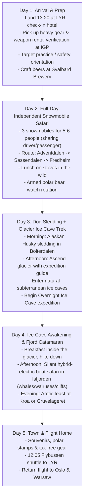

# Svalbard Adventure & Activity Guide (5–6 Person Group)
*Target Dates: Early May (5 Days / 4 Nights)*
*Focus: Ice Cave Overnight, Remote Wilderness Cabins, Independent Snowmobiling & Polar Bear Safety*

---

## 1. Group Profile & Key Feasibility Assessment

* **Group Size:** 5–6 adults (experienced in mountain hiking/outdoor expeditions).
* **Season (Early May):** 24-hour Midnight Sun, snow cover is firm across valleys and high passes, temperatures typically range from $-6^\circ\text{C}$ to $0^\circ\text{C}$ (wind chill can drop to $-15^\circ\text{C}$).
* **Key Ambitions:**
  1. Overnight inside an ice cave or in a remote off-grid wilderness cabin ("in the middle of nowhere").
  2. One-day independent snowmobile self-drive without a guide using own polar bear weapon authorization.

---

## 2. Sleeping in the Middle of Nowhere: Ice Cave vs. Remote Cabin

You have two extraordinary options in early May: sleeping literally inside an Arctic glacier, or staying in one of Svalbard's historic off-grid wilderness lodges.

### Option A: The Glacier Ice Cave Overnight (Most Extreme)
* **What it is:** A true Arctic survival experience operated with an expedition guide (e.g. *Svalbard Wildlife Expeditions* / *Frostbite Expeditions*).
* **The Experience:**
  * Hike/snowshoe up with expedition backpacks from Longyearbyen (or snowmobile transfer) to the Larsbreen or Longyearbreen glacier (~400m elevation gain).
  * Rappel or descend via ladder down into a sub-surface meltwater chamber carved deep inside the blue glacier ice.
  * Dinner is cooked on expedition stoves inside an ice hall surrounded by crystal chandeliers.
  * You sleep on high-R-value insulated pads in extreme sub-zero expedition sleeping bags (rated down to $-30^\circ\text{C}$). The ice cave maintains a steady, windless $-3^\circ\text{C}$ to $-5^\circ\text{C}$ regardless of the storm outside.
* **Why hire a guide for this:** Glaciers move constantly; an experienced glaciology guide inspects structural stability, sets anchors, maintains gas/ventilation monitors, and stays armed at the cave entrance for polar bear watch.
* **Estimated Cost:** ~3,500 – 4,800 NOK (~€300 – €415 / ~1,300 – 1,800 PLN) per person, including all technical gear, sleeping systems, dinner, and guide.

### Option B: Remote Wilderness Cabin / Outpost (Nordenskiöld Lodge or Trapper's Cabin)
If you want the sensation of being 100 km from the nearest civilization with warmth and a wood-fired sauna:
* **Nordenskiöld Lodge (Billefjorden):** 
  * The most remote commercial lodge on earth, situated right against the calving face of the massive Nordenskiöldbreen glacier.
  * No roads, no electricity grid, no running water—heated entirely by wood and oil lamps, with a traditional Scandinavian wood-fired sauna overlooking the glacier.
  * Reached via a full-day snowmobile expedition across the frozen wilderness.
* **Isfjord Radio (Kapp Linné):**
  * A luxury outpost at the outer edge of Isfjorden, previously a radio communications relay station in polar bear country.
* **Trapper’s Station (Bolterdalen):**
  * Modeled after 19th-century Arctic fur hunters' lodges, surrounded by 90 Alaskan huskies.

---

## 3. Independent Snowmobile Rental: Feasibility & Risk Assessment

You asked: *"For one day we want to rent snowmobiles by ourselves (we have weapon license against bears) if it's not super risky."*

### Is it legally possible?
**YES.** Unlike general casual tourists, independent self-drive snowmobile rental is legally permitted in Longyearbyen if you meet strict criteria. The main rental fleet is operated by **Ingeniør G. Paulsen (IGP)** (part of Hurtigruten Svalbard, located in Sjøområdet, Longyearbyen).

### Legal & Safety Requirements for Independent Rental:
1. **Driver’s License:**
   * Every driver must present a valid **physical Category B (passenger car)** or motorcycle/snowmobile license (Polish / EU licenses are fully recognized under the Vienna Convention).
2. **Polar Bear Protection (Weapon & Flare Gun):**
   * By law (*Svalbard Environmental Protection Act*), anyone traveling outside the Longyearbyen safety perimeter **must** carry adequate polar bear defense.
   * Rental shops (IGP, Sportscenteret, Longyear78) will rent you a **.30-06 or .308 bolt-action rifle and a Cal. 4 signal flare pistol**, provided you show valid documentation.
   * **License Procedure:** Because you have a firearms license in Poland:
     * If you hold an official **European Firearms Pass (Europejska Karta Broni Palnej)**, local outfitters can rent you a rifle on the spot without filing a prior governor permit!
     * If you only hold a domestic national Polish gun license, you must submit a rental permit application to the **Sysselmesteren (The Governor of Svalbard)** via their portal (`firmapost@sysselmesteren.no`) **4 to 6 weeks in advance**, along with a police record certificate issued within 3 months and English translation.
3. **Mandatory Safety Equipment from Rental Shop:**
   * Handheld GPS with Svalbard topographic trail maps.
   * Satellite communicator (e.g., **Garmin inReach** or Iridium satellite beacon for SOS).
   * Avalanche shovel, snow probe, and breakdown tow-rope.
   * Spare jerry cans with fuel.

---

### Risk Analysis: Is it "Super Risky" in Early May?

```mermaid
quadrantChart
    title Svalbard Route Risk Assessment (Early May)
    x-axis Low Technical Difficulty --> High Technical Difficulty
    y-axis Low Severe Hazard --> High Severe Hazard
    quadrant-1 DO NOT GO (Guide Mandatory)
    quadrant-2 High Hazard / Hidden Danger
    quadrant-3 Safe Self-Drive Corridor
    quadrant-4 Moderate Technical Excursion
    "Adventdalen to Sassendalen": [0.25, 0.20]
    "Valley to Fredheim trapper cabin": [0.30, 0.28]
    "Longyearbreen Glacier Traverse": [0.75, 0.85]
    "East Coast Pack Ice": [0.85, 0.90]
    "Fjord Sea Ice Crossing (Tempelfjorden)": [0.55, 0.80]
    "Colesdalen to Russian Barentsburg": [0.50, 0.45]
```

#### Low-Risk (Recommended for your Self-Drive Day):
* **The Main Valley Corridor:** Riding from Longyearbyen through **Adventdalen $\rightarrow$ Helvetiadalen $\rightarrow$ Sassendalen to Villa Fredheim** (the historic trapper cabin of Hilmar Nøis) is wide, well-traveled by locals, has zero glacier crevasses, and allows safe 50–70 km round-trip cruising.
* **Why it is safe:** You follow flat, snow-filled river valleys with high visibility, easy navigation, and reliable mobile or satellite connectivity.

#### Severe Risks (What you MUST avoid without a local guide):
1. **Glacier Crevasses:** Snowmobiling over untracked glaciers (like Larsbreen or Nordenskiöldbreen) is extremely dangerous in spring because snow bridges can disguise 30-meter deep crevasses. Never drive on a glacier unless following a guided convoy that monitors crevasse maps.
2. **Thinning Sea Ice:** In early May, sea ice in Tempelfjorden and Adventfjorden begins to rot and crack from tidal currents. Local guides measure ice thickness with ice augers daily; self-drivers who drive onto sea ice without knowing current tidal conditions risk drowning machines and riders.
3. **Whiteout Weather:** In a blizzard or Arctic fog, you lose depth perception within 60 seconds (ground and sky merge into a flat white void). Having a pre-programmed track on a Garmin GPS and never leaving the valley trail is essential.

> [!TIP]
> **Verdict for Your Group:** For your 1-day independent rental, stick to the **Adventdalen – Sassendalen – Fredheim corridor**. It provides an authentic, high-speed wilderness experience with zero crevasse hazards and stunning Arctic panorama, without betting your life on tricky sea ice.

---

## 4. Recommended 5-Day Master Activity Program (5–6 Person Group)

Here is a curated itinerary tailored for an active, experienced outdoor group that blends independent adventure with elite guided wilderness experiences:



---

## 5. Budget Estimation for Group Activities (Per Person)

| Activity | Provider / Format | Approx. Cost (NOK) | Approx. Cost (PLN) | Approx. Cost (EUR) |
| :--- | :--- | :--- | :--- | :--- |
| **Independent Snowmobile Rental (1 Day)** | IGP (3 sleds shared among 5–6) | ~1,600 – 2,200 NOK | ~600 – 830 PLN | ~€140 – €190 |
| **Rifle & Flare Gun Rental + Ammo** | IGP / Sportscenteret (2 rifles for group) | ~400 – 600 NOK | ~150 – 225 PLN | ~€35 – €52 |
| **Glacier Ice Cave Overnight Expedition** | Svalbard Wildlife Expeditions | ~3,800 – 4,800 NOK | ~1,430 – 1,800 PLN | ~€330 – €415 |
| **Dog Sledding Safari (Half-Day)** | Svalbard Husky / Green Dog | ~1,850 – 2,200 NOK | ~700 – 830 PLN | ~€160 – €190 |
| **Hybrid Boat Fjord Safari (Optional)** | Brim Explorer / Better Moments | ~1,700 – 2,100 NOK | ~640 – 790 PLN | ~€145 – €180 |
| **Total Estimated Activities Budget** | *(Excluding flights & hotel)* | **~7,500 – 9,500 NOK** | **~2,800 – 3,600 PLN** | **~€650 – €825** |

---

## 6. Action Items & Deadlines for the Organizer

1. **Firearms Documentation (Submit in March):**
   * Verify which group members hold an official **European Firearms Pass (EFP)**.
   * If applying via the Governor (*Sysselmesteren*), request a clean criminal record certificate from the Polish Ministry of Justice in Polish and English, and submit the online application at least 5 weeks before travel.
2. **Reserve the Ice Cave Overnight Early:**
   * Ice cave overnights have a strict maximum capacity of 6–8 people. Since your group is 5–6, you will essentially take the entire tour exclusively!
3. **Reserve Snowmobiles at IGP:**
   * Touring sleds (e.g. Yamaha Venture Multi-Purpose or Polaris Nordic Pro with 2-up seating and luggage racks) sell out weeks in advance for early May.
