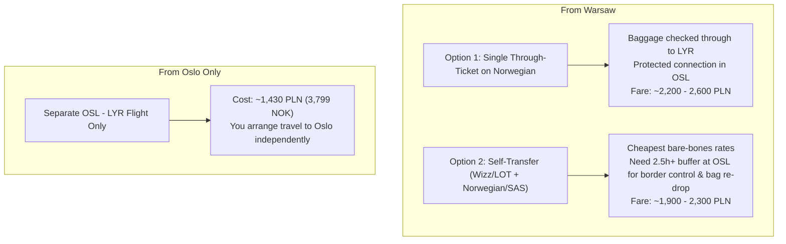
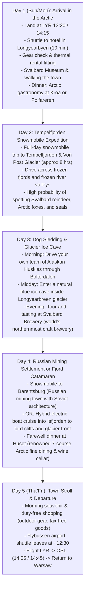

# Svalbard (Longyearbyen) Vacation Flight & Travel Plan
*5-Day / 4-Night Arctic Adventure (Early May Window)*
*Origin Analysis: Warsaw (WAW) $\rightarrow$ Oslo (OSL) $\rightarrow$ Svalbard (LYR)*

---

## 1. Executive Summary & Route Overview

* **Primary Route:** Warsaw Chopin (**WAW**) $\rightarrow$ Oslo Gardermoen (**OSL**) $\rightarrow$ Longyearbyen (**LYR**)
* **Selected Duration:** **5 Days / 4 Nights**
* **Target Windows:** 
  * **Option A (Best Value):** **Sunday, May 03 – Thursday, May 07**
  * **Option B (Work-Week Run):** **Monday, May 04 – Friday, May 08**
  * **Option C (May Day Extended):** **Wednesday, April 29 – Sunday, May 03** or **Friday, May 01 – Tuesday, May 05**
* **Airlines:**
  * **Warsaw $\leftrightarrow$ Oslo:** Norwegian, LOT Polish Airlines, Wizz Air
  * **Oslo $\leftrightarrow$ Longyearbyen:** Norwegian Air Shuttle, SAS (Scandinavian Airlines)
* **Arctic Season Conditions:** Midnight Sun is fully active (24-hour continuous daylight since April 20). Mountain and valley snowpack is firm, making early May the premier window for snowmobile safaris, glacier ice caves, and dog sledding before the summer thaw.

---

## 2. Flight Leg 1: Warsaw (WAW) $\leftrightarrow$ Oslo Gardermoen (OSL)

> [!IMPORTANT]
> **Airport Choice Warning:** Always fly into **Oslo Gardermoen (OSL)**, not Sandefjord Torp (TRF). Torp is over 120 km south of Oslo and requires a 2-hour bus/train transfer costing ~350 NOK each way. All flights to Svalbard depart strictly from Gardermoen (OSL).

### Warsaw to Oslo Outbound Options

| Airline | Flight No. | Typical Departure (WAW) | Typical Arrival (OSL) | Flight Time | One-Way Fare (Light) | One-Way Fare (+23kg Bag) |
| :--- | :--- | :--- | :--- | :--- | :--- | :--- |
| **Wizz Air** | `W6 1505` | 06:15 – 06:45 | 08:20 – 08:50 | 2h 05m | ~120 – 190 PLN (~€28 – €44) | ~250 – 330 PLN (~€58 – €77) |
| **Norwegian** | `D8 5053` | 10:45 – 13:30 | 12:45 – 15:30 | 2h 00m | ~190 – 320 PLN (~€44 – €75) | ~340 – 480 PLN (~€79 – €112) |
| **LOT Polish** | `LO 481` / `483` | 07:55 / 16:50 | 10:00 / 18:55 | 2h 05m | ~280 – 450 PLN (~€65 – €105)| ~420 – 590 PLN (~€98 – €138) |

### Oslo to Warsaw Return Options

| Airline | Flight No. | Typical Departure (OSL) | Typical Arrival (WAW) | Flight Time | One-Way Fare (Light) | One-Way Fare (+23kg Bag) |
| :--- | :--- | :--- | :--- | :--- | :--- | :--- |
| **LOT Polish** | `LO 484` | 19:40 – 20:35 | 21:40 – 22:35 | 2h 00m | ~290 – 480 PLN (~€68 – €112)| ~430 – 620 PLN (~€100 – €145)|
| **Norwegian** | `D8 5052` | 13:55 – 18:20 | 15:55 – 20:20 | 2h 00m | ~190 – 340 PLN (~€44 – €80) | ~340 – 490 PLN (~€79 – €114) |
| **Wizz Air** | `W6 1506` | 09:25 – 19:15 | 11:30 – 21:20 | 2h 05m | ~130 – 210 PLN (~€30 – €49) | ~260 – 350 PLN (~€61 – €82) |

---

## 3. Flight Leg 2: Oslo Gardermoen (OSL) $\leftrightarrow$ Svalbard (LYR)

### Outbound Flights (OSL $\rightarrow$ LYR)

| Date | Carrier | Flight No. | Dep OSL | Arr LYR | Duration | Base Fare (No Bag) | Fare (Incl. 23kg Bag) |
| :--- | :--- | :--- | :--- | :--- | :--- | :--- | :--- |
| **Sun May 03** | Norwegian | `DY390` | 10:20 | 13:20 | 3h 00m | 1,499 NOK (~565 PLN / €130) | 1,899 NOK (~715 PLN / €165) |
| **Sun May 03** | SAS | `SK4490` | 11:15 | 14:15 | 3h 00m | 1,590 NOK (~600 PLN / €138) | 2,040 NOK (~770 PLN / €177) |
| **Mon May 04** | Norwegian | `DY390` | 10:20 | 13:20 | 3h 00m | 1,399 NOK (~528 PLN / €122) | 1,799 NOK (~678 PLN / €156) |
| **Mon May 04** | SAS | `SK4490` | 11:15 | 14:15 | 3h 00m | 1,490 NOK (~562 PLN / €130) | 1,940 NOK (~732 PLN / €169) |
| **Wed Apr 29** | Norwegian | `DY390` | 10:20 | 13:20 | 3h 00m | 1,399 NOK (~528 PLN / €122) | 1,799 NOK (~678 PLN / €156) |
| **Fri May 01** | Norwegian | `DY390` | 10:20 | 13:20 | 3h 00m | 1,599 NOK (~603 PLN / €139) | 1,999 NOK (~754 PLN / €174) |

### Inbound Flights (LYR $\rightarrow$ OSL)

| Date | Carrier | Flight No. | Dep LYR | Arr OSL | Duration | Base Fare (No Bag) | Fare (Incl. 23kg Bag) |
| :--- | :--- | :--- | :--- | :--- | :--- | :--- | :--- |
| **Thu May 07** | SAS | `SK4491` | 14:45 | 17:45 | 3h 00m | 1,450 NOK (~547 PLN / €126) | 1,900 NOK (~716 PLN / €165) |
| **Fri May 08** | Norwegian | `DY391` | 14:05 | 17:05 | 3h 00m | 1,599 NOK (~603 PLN / €139) | 1,999 NOK (~754 PLN / €174) |
| **Sun May 03** | Norwegian | `DY391` | 14:05 | 17:05 | 3h 00m | 1,799 NOK (~678 PLN / €156) | 2,199 NOK (~830 PLN / €191) |
| **Tue May 05** | SAS | `SK4491` | 14:45 | 17:45 | 3h 00m | 1,420 NOK (~535 PLN / €123) | 1,870 NOK (~705 PLN / €162) |

---

## 4. Master Flight Timetables & Door-to-Door Schedules

> [!NOTE]
> **No Time Zone Changes:** Warsaw (WAW), Oslo (OSL), and Longyearbyen (LYR) all operate on the exact same time zone in May: **Central European Summer Time (CEST / UTC+2)**. All departure and arrival times listed below are identical to local clock time in Poland, Norway, and Svalbard.

---

### Scenario A: Sunday, May 03 – Thursday, May 07 (Top Recommended Window)

#### Outbound: Sunday, May 03 (Warsaw $\rightarrow$ Longyearbyen)
* **Total Door-to-Door Transit Time:** **7h 05m** *(from takeoff in Warsaw to landing in Svalbard)*

| Step | Flight / Activity | Departure Time | Arrival Time | Duration | Notes |
| :--- | :--- | :--- | :--- | :--- | :--- |
| **Leg 1** | Wizz Air `W6 1505` | **06:15** (WAW) | **08:20** (OSL) | 2h 05m | Warsaw Chopin to Oslo Gardermoen |
| **Layover**| Self-transfer & Border Control | 08:20 (OSL) | 10:20 (OSL) | 2h 00m | Claim bag, check-in Norwegian, clear Gate F passport control |
| **Leg 2** | Norwegian `DY390` | **10:20** (OSL) | **13:20** (LYR) | 3h 00m | Direct non-stop flight over the Arctic Ocean to Svalbard |
| **Transfer**| Svalbard Airport Bus (`Flybussen`)| 13:40 (LYR) | 13:55 (Hotel) | 15 min | Meets every arriving flight; drops at hotel doors |

*(Alternative SAS connection: LOT `LO 481` 07:55–10:00 WAW-OSL, followed by SAS `SK4490` 11:15–14:15 OSL-LYR).*

#### Inbound: Thursday, May 07 (Longyearbyen $\rightarrow$ Warsaw)
* **Total Door-to-Door Transit Time:** **7h 50m** *(from takeoff in Svalbard to landing in Warsaw)*

| Step | Flight / Activity | Departure Time | Arrival Time | Duration | Notes |
| :--- | :--- | :--- | :--- | :--- | :--- |
| **Transfer**| Svalbard Airport Bus (`Flybussen`)| 12:45 (Hotel) | 13:00 (LYR) | 15 min | Pick-up outside Longyearbyen hotel reception |
| **Leg 1** | SAS `SK4491` | **14:45** (LYR) | **17:45** (OSL) | 3h 00m | Direct flight from Svalbard to Oslo Gardermoen |
| **Layover**| Transit & Schengen Re-Entry | 17:45 (OSL) | 20:35 (OSL) | 2h 50m | Smooth transfer window, dinner at Gardermoen food court |
| **Leg 2** | LOT Polish Airlines `LO 484` | **20:35** (OSL) | **22:35** (WAW) | 2h 00m | Non-stop back to Warsaw Chopin |

#### Estimated Total Cost (Scenario A)
* **Airfare:** ~2,030 – 2,400 PLN (~€470 – €555) round-trip per person (including 23kg checked bag on both legs).

---

### Scenario B: Monday, May 04 – Friday, May 08 (All-Norwegian Option)

#### Outbound: Monday, May 04 (Warsaw $\rightarrow$ Longyearbyen)
* **Total Door-to-Door Transit Time:** **7h 05m**

| Step | Flight / Activity | Departure Time | Arrival Time | Duration | Notes |
| :--- | :--- | :--- | :--- | :--- | :--- |
| **Leg 1** | Wizz Air `W6 1505` | **06:15** (WAW) | **08:20** (OSL) | 2h 05m | Morning feeder to Gardermoen |
| **Layover**| Connection Buffer | 08:20 (OSL) | 10:20 (OSL) | 2h 00m | Baggage drop & Gate F passport exit |
| **Leg 2** | Norwegian `DY390` | **10:20** (OSL) | **13:20** (LYR) | 3h 00m | Non-stop to Longyearbyen |
| **Transfer**| Airport Shuttle Bus | 13:40 (LYR) | 13:55 (Hotel) | 15 min | Transfer to town accommodations |

#### Inbound: Friday, May 08 (Longyearbyen $\rightarrow$ Warsaw)
* **Total Door-to-Door Transit Time:** **6h 45m – 8h 30m**

| Step | Flight / Activity | Departure Time | Arrival Time | Duration | Notes |
| :--- | :--- | :--- | :--- | :--- | :--- |
| **Transfer**| Airport Shuttle Bus | 12:05 (Hotel) | 12:20 (LYR) | 15 min | Scheduled specifically for `DY391` |
| **Leg 1** | Norwegian `DY391` | **14:05** (LYR) | **17:05** (OSL) | 3h 00m | Non-stop flight LYR to OSL |
| **Layover**| Connection Buffer | 17:05 (OSL) | 18:50 / 20:35 | 1h 45m / 3h 30m | Re-enter Schengen area |
| **Leg 2 (Option 1)**| Norwegian `D8 5052` | **18:50** (OSL) | **20:50** (WAW) | 2h 00m | Fastest return connection (**6h 45m total**) |
| **Leg 2 (Option 2)**| LOT Polish `LO 484` | **20:35** (OSL) | **22:35** (WAW) | 2h 00m | Relaxed 3h 30m dinner buffer at OSL |

#### Estimated Total Cost (Scenario B)
* **Airfare:** ~2,010 – 2,230 PLN (~€465 – €515) round-trip per person (including 23kg checked bag).

---

### Scenario C: Thursday, April 30 – Sunday, May 03 (4-Day Long Weekend)

#### Outbound: Thursday, April 30
* **Leg 1:** Wizz Air `W6 1505` (WAW **06:15** $\rightarrow$ OSL **08:20**, 2h 05m)
* **OSL Layover:** 2h 35m
* **Leg 2:** SAS `SK4490` (OSL **10:55** $\rightarrow$ LYR **13:55**, 3h 00m) or Norwegian `DY390` (10:20 $\rightarrow$ 13:20)
* **Total Transit Time:** **7h 40m**

#### Inbound: Sunday, May 03
* **Transfer:** `Flybussen` pickup from hotel at **12:05**
* **Leg 1:** Norwegian `DY391` (LYR **14:05** $\rightarrow$ OSL **17:05**, 3h 00m)
* **OSL Layover:** 3h 30m
* **Leg 2:** LOT Polish `LO 484` (OSL **20:35** $\rightarrow$ WAW **22:35**, 2h 00m)
* **Total Transit Time:** **8h 30m**

---

### Flight Time & Transit Rules Quick Reference

| Flight Route | Scheduled Flight Time | Typical Departure Window | Typical Arrival Window |
| :--- | :--- | :--- | :--- |
| **Warsaw (WAW) $\rightarrow$ Oslo (OSL)** | **2 hours 05 minutes** | 06:15 (Morning) / 07:55 / 16:50 | 08:20 / 10:00 / 18:55 |
| **Oslo (OSL) $\rightarrow$ Svalbard (LYR)** | **3 hours 00 minutes** | 10:20 (Norwegian) / 10:55–11:15 (SAS) | 13:20 (Norwegian) / 13:55–14:15 (SAS) |
| **Svalbard (LYR) $\rightarrow$ Oslo (OSL)** | **3 hours 00 minutes** | 14:05 (Norwegian) / 14:45 (SAS) | 17:05 (Norwegian) / 17:45 (SAS) |
| **Oslo (OSL) $\rightarrow$ Warsaw (WAW)** | **2 hours 00 minutes** | 18:50 (Norwegian) / 20:35 (LOT) | 20:50 / 22:35 |

* **Airport Check-in Cutoffs:** Check-in and bag drop closes strictly **45 minutes** before departure at OSL and LYR.
* **Non-Schengen Gate F at OSL:** The international border gates at Oslo require queuing through automated electronic passport gates. Allow **20–30 minutes** before boarding time.
* **Svalbard Airport Shuttle:** The shuttle bus (`Svalbardbuss`) is synced with every flight arrival and departure. You never need to book a taxi in advance—buses wait right outside the arrivals doors and stop at all hotels in Longyearbyen.

---

## 5. Comparison: Booking from Warsaw vs. Booking from Oslo



* **Savings Reality:** Flights between Warsaw and Oslo are very cheap (often under 250 PLN each way), so starting from Warsaw only adds **~500 – 750 PLN (€115 – €175)** to your total airfare.
* **Through-ticket with Norwegian:** You can book `WAW` to `LYR` on a single reservation via [Norwegian.com](https://www.norwegian.com). While it might be 150–250 PLN more than split tickets, your luggage is protected and transferred automatically, avoiding stress if the feeder flight is delayed.

---

## 6. Daily Itinerary Blueprint for 5 Days / 4 Nights



---

## 7. Crucial Practical Checklist for Poland $\rightarrow$ Svalbard

1. **Passport Required (No National ID Cards):**
   * Even though Poland and Norway are Schengen countries, **Svalbard is not in Schengen**.
   * Polish authorities and Norwegian police require a **valid passport** to pass border control at Oslo Gardermoen when leaving and re-entering mainland Norway.
2. **Transfer Time Buffer at OSL:**
   * If booking separate tickets (e.g. Wizz Air into OSL and Norwegian out of OSL), leave at least **2.5 to 3 hours** between flights. You must clear Norwegian customs, re-drop luggage, and pass through non-Schengen passport control (Gate F area).
3. **Arctic Pack Checklist:**
   * Merino wool thermal base layers (top and bottom) $\times 2$.
   * Windproof and waterproof shell jacket and pants.
   * Polarized sunglasses & sunscreen (with 24h sun reflecting off white snow, snow blindness/sunburn is a real risk).
   * High-quality contoured sleep mask (hotels have blinds, but 24h daylight penetrates easily).
   * *Note:* Tour operators provide heavy snowmobile outer suits, helmets, balaclavas, and sub-zero boots for excursions.

---

## 8. Direct Booking & Official Resources

* [Norwegian Air Shuttle (Book WAW-LYR or OSL-LYR)](https://www.norwegian.com)
* [Scandinavian Airlines SAS](https://www.flysas.com)
* [LOT Polish Airlines (WAW-OSL)](https://www.lot.com)
* [Visit Svalbard Excursion Booking](https://en.visitsvalbard.com)

---

## 9. When to Buy & Pre-Christmas Discount Opportunities

### Can you get a discount before Christmas?
**Yes, specifically during Black Friday / Black Week in late November.**

Both Norwegian and Wizz Air (and to a lesser extent SAS and LOT) run their biggest sales of the fourth quarter during late November:

1. **Norwegian Air "Black Week / Black Friday" (Late November):**
   * **When:** Annually during the last week of November (running through Cyber Monday / early December).
   * **Travel Window:** Promos specifically target spring travel (typically December through mid-June), covering the late April / early May dates.
   * **Typical Discount:** Up to **15% to 30% off** selected routes via annual promo codes (e.g., `BLACKWEEK`, `BLACKFRIDAY`).
   * **Impact on Svalbard:** Norwegian operates direct `OSL` $\rightarrow$ `LYR` and `WAW` $\rightarrow$ `OSL`. In past campaigns, Norwegian's base fares have dropped towards ~1,000–1,150 NOK (~400–450 PLN) each way.
2. **Wizz Air & LOT Black Week:**
   * **Wizz Air "Pink / Black Friday":** 20%–25% off European flights, providing rock-bottom feeder fares for `WAW` $\rightarrow$ `OSL` (~80–120 PLN one-way).
   * **LOT "Black Week":** 15%–20% off European short-haul network.
3. **December / Advent Calendar Sales ("Julekalender"):**
   * Both SAS and Norwegian occasionally run daily advent calendar flash deals during December. However, these are unpredictable 24-hour single-destination sales, making them less reliable than Black Friday for a specific destination like Svalbard.

### Recommended Purchase Strategy & Timeline

```
[Late October]  --> Track baseline low-fare price (~1,399 NOK OSL-LYR on Norwegian)
      │
[Late November] --> ⭐ PRIME WINDOW: Black Friday / Cyber Monday Sales (Target: 15-30% off)
      │
[Early January] --> Back-up: Big New Year Airline Sales
      │
[Feb - April]   --> ⚠️ DANGER ZONE: Seats fill up, prices steadily climb as May approaches
```

* **Best Time to Book:** **Between late November (Black Friday) and mid-January.**
* **Hard Cutoff:** Do not wait past **mid-February**. Because Svalbard has only 1–2 scheduled flights per day and hotel capacity is strictly capped, seat inventory dries up quickly. As spring snowmobile tourism accelerates, fares rarely drop in March or April—they only rise.

