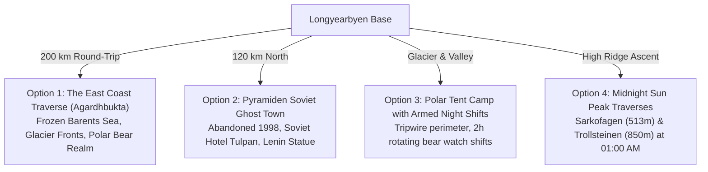
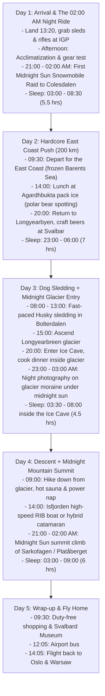

# Svalbard: High-Intensity "Less Sleep" & Alternative Expeditions
*For Experienced Hikers & 5–6 Person Mountain Groups | Early May*
*Harnessing the 24-Hour Midnight Sun: Extreme Night Shifts, Ghost Towns & Pack Ice*

---

## 1. The "Midnight Sun" Secret: Why You Don't Need to Sleep at Night

In early May, **the sun never sets** in Svalbard. It hovers low on the northern horizon at midnight, casting a deep golden, windless glow across the glaciers.

Because it is broad daylight 24 hours a day, you are **not restricted to a 9-to-5 schedule**. For an experienced mountain group that wants maximum adrenaline and less time wasted in bed, you can flip your circadian rhythm or operate on a **split-sleep cycle** (4 hours of sleep midday, active all evening and night when the trails are completely empty).

---

## 2. Four Extreme Alternative Routes & Overnights

---

### Option 1: The East Coast Snowmobile Traverse (The Polar Bear Realm)
* **The Route:** Longyearbyen $\rightarrow$ Adventdalen $\rightarrow$ Sassendalen $\rightarrow$ Agardhbukta / Mohnbukta (East Coast of Spitsbergen).
* **Distance:** **~190 – 220 km round-trip** (10 to 12 hours of hardcore backcountry riding).
* **Why it's incredible:** The West Coast is warmed by the Gulf Stream, but the East Coast is locked in Siberian-origin sea pack ice. This is the **hunting ground of the polar bear**, where mother bears and cubs hunt ringed seals on the sea ice.
* **Sleeping impact:** You return to town at 23:00 completely exhausted, eat dinner under the midnight sun, and ride on pure adrenaline.
* **Format:** Requires a licensed armed guide or 2 armed scouts with GPS navigation and emergency satellite trackers.

---

### Option 2: Overnight in Pyramiden (Soviet Ghost Town Frozen in Time)
* **The Route:** Snowmobile north across Nordenskiöld Land and Tempelfjorden to **Pyramiden**, an abandoned Russian coal mining town abandoned overnight in 1998.
* **The Experience:**
  * Ride past the towering, blue-crevassed wall of the **Nordenskiöld Glacier**.
  * Explore the preserved Soviet Cultural Palace, Olympic-size swimming pool, library, world's northernmost grand piano, and the northernmost statue of Lenin.
  * **The Overnight:** Sleep at **Hotel Tulpan** (Hotel Pyramiden), staffed by a handful of Russian caretakers. Drink Russian tea or vodka, eat hearty borscht, and sleep in an eerily silent abandoned Soviet city.
* **Distance:** ~110 km each way (2-day expedition).

---

### Option 3: Polar Tent Camp with Armed Night Watch (True "Less Sleep")
If your group wants an authentic polar expedition where sleep is strictly minimized and functional:
* **The Setup:** Pitch heavy-duty four-season expedition tents (Hilleberg / Mountain Hardwear) on the snow in a remote valley (e.g., Sassendalen or Foxdalen).
* **The Polar Bear Perimeter:** Set up a tripwire flare alarm perimeter around the camp.
* **The "Shift Sleep" System:** 
  * Because a polar bear can approach silently, **someone must always be awake outside with a loaded .30-06 rifle and flare gun**.
  * For a group of 6, each person takes a **1.5 to 2-hour night guard shift** while the others sleep in polar sleeping bags.
  * While on watch between 01:00 AM and 03:00 AM, you stand in silence under the bright golden midnight sun, watching reindeer graze and scanning the horizon for bears.

---

### Option 4: Midnight Sun Mountain Peak Traverses (Night Mountaineering)
Instead of hiking during the afternoon when everyone else is outside, start your climbs at **21:00 or 22:00**:
* **Peak 1: Sarkofagen Ridge (513m):** 
  * Ascend between the Larsbreen and Longyearbreen glaciers. 
  * Stand on the razor-sharp knife-edge summit at **00:30 AM** looking down at Isfjorden glowing red and gold under the midnight sun.
* **Peak 2: Trollsteinen (850m):**
  * Highest easily accessible peak near Longyearbyen. Requires crampons or snowshoes and glacier ropes across frozen snow bridges.
  * Descent down the glacier by headlamp-free midnight snowshoeing.

---

## 3. High-Intensity 5-Day "Less Sleep" Itinerary

This itinerary is designed for maximum action, using the 24-hour sun to compress 10 days of adventure into 5 days:

---

## 4. Price Impact of the "Less Sleep / Extreme" Route

| Activity Added | Cost Per Person (NOK) | Cost Per Person (PLN) | Notes |
| :--- | :--- | :--- | :--- |
| **East Coast Snowmobile Guide & Fuel** | ~3,900 – 4,800 NOK | ~1,470 – 1,800 PLN | Replaces standard valley tour with a 200km expedition |
| **Midnight Sun Peak Hike (Armed Guide)** | ~950 – 1,250 NOK | ~360 – 470 PLN | 4–5 hour midnight mountain traverse |
| **Ice Cave Overnight** | ~3,800 – 4,500 NOK | ~1,430 – 1,700 PLN | Same as base plan |
| **Dog Sledding Safari** | ~1,850 NOK | ~700 PLN | Fast morning run |
| **Total Activities Cost** | **~10,500 – 12,400 NOK** | **~3,960 – 4,670 PLN** | *(Excluding flights & hotels)* |
| **TOTAL TRIP COST (Per Person, All-In)** | **~21,500 – 25,000 NOK** | **~8,100 – 9,500 PLN** | **~€1,890 – €2,220** |

---

## 5. Critical Safety Rules for High-Intensity / Low-Sleep Trips

1. **Cold Fatigue is Real:**
   * In $-5^\circ\text{C}$ to $-15^\circ\text{C}$ temperatures, sleep deprivation drains your core calories 50% faster than at room temperature.
   * *Rule:* Never drive snowmobiles or cross glaciers if anyone is experiencing micro-sleep or sluggish reflexes.
2. **Polar Bear Reaction Times:**
   * A charging polar bear covers 100 meters in under 8 seconds. 
   * Anyone assigned to rifle watch during night hours **must be 100% awake, sober, and warm**. Rotate guards every 90 to 120 minutes so nobody dozes off in the cold.
3. **Carry High-Calorie Snacks Constantly:**
   * When running on 4–5 hours of sleep, pack dried reindeer meat, nuts, high-protein chocolate, and thermoses of hot blackcurrant toddy (*solbærtoddy*) on every sled.
