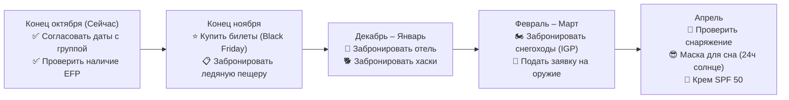

# 🏔️ Шпицберген: Сводка по Экспедиции
*Группа: 5–6 человек | 5 дней / 4 ночи | Начало мая*
*Маршрут: Варшава (WAW) → Осло (OSL) → Лонгйир (LYR)*

---

## 1. Ключевые Параметры Поездки

| Параметр | Детали |
| :--- | :--- |
| **Даты** | **Вс 3 мая – Чт 7 мая** *(или Пн 4 мая – Пт 8 мая)* |
| **Длительность** | **5 дней / 4 ночи** (3 ночи в отеле + 1 ночь внутри ледника) |
| **Группа** | **5–6 взрослых** (опытные горные туристы, есть оружейная лицензия) |
| **Сезон** | Полярный день (солнце не заходит 24/7), снежный покров стабильный |
| **Бюджет на человека** | **~7 700 – 8 900 PLN** (~€1 800 – €2 080) |
| **Бюджет на группу (6 чел.)** | **~46 000 – 53 000 PLN** (~€10 800 – €12 400) |

---

## 2. Перелёты: Расписание и Стоимость

### Маршрут
```
Варшава (WAW) ──[2ч 05м]──► Осло (OSL) ──[3ч 00м]──► Лонгйир (LYR)
   Wizz Air / LOT                  Norwegian / SAS
```

> **Часовые пояса:** Варшава, Осло и Лонгйир — всё CEST (UTC+2) в мае. Время одинаковое во всех трёх точках.

### Расписание Перелётов

| Направление | Рейс | Вылет | Прилёт | Время в пути |
| :--- | :--- | :--- | :--- | :--- |
| **WAW → OSL** | Wizz Air `W6 1505` | **06:15** (Варшава) | **08:20** (Осло) | 2ч 05м |
| **OSL → LYR** | Norwegian `DY390` | **10:20** (Осло) | **13:20** (Шпицберген) | 3ч 00м |
| **LYR → OSL** | SAS `SK4491` | **14:45** (Шпицберген) | **17:45** (Осло) | 3ч 00м |
| **OSL → WAW** | LOT `LO 484` | **20:35** (Осло) | **22:35** (Варшава) | 2ч 00м |

### Стоимость Перелётов (на человека, с багажом 23 кг)

| Вариант бронирования | Стоимость (PLN) | Стоимость (EUR) |
| :--- | :--- | :--- |
| **Раздельные билеты** (Wizz/LOT + Norwegian/SAS) | **~1 600 – 1 950 PLN** | **~€370 – €450** |
| **Единый билет Norwegian** (WAW→OSL→LYR, багаж включён) | **~2 000 – 2 350 PLN** | **~€460 – €545** |

### Когда покупать билеты?
* ⭐ **Лучшее время:** Конец ноября (**Black Friday / Black Week**) — скидки 15%–30% на весенние рейсы Norwegian.
* **Крайний срок:** Не позже середины февраля — места быстро заканчиваются.
* **Текущие цены (октябрь):** SAS загрузил базовые тарифы от **€87** в одну сторону (Осло → Шпицберген).

---

## 3. Программа по Дням

### День 1: Прилёт и Акклиматизация
* **06:15–13:20:** Перелёт Варшава → Осло → Лонгйир (пересадка 2 часа в Осло).
* **14:00:** Заселение в отель, получение арктической экипировки и снегоходов в *Ingeniør G. Paulsen (IGP)*.
* **Вечер:** Приветственный ужин в ресторане *Kroa* (бургер из оленины, арктическая треска). Полярный день — солнце не заходит.

### День 2: Самостоятельное Сафари на Снегоходах (Адвентдален → Фредхейм)
* **09:00:** 3 снегохода на группу + 2 карабина (.30-06) + сигнальные ракетницы + GPS-трекер (Garmin inReach).
* **Маршрут:** Широкая долина Адвентдален → Сассендален → историческая хижина охотника Хилмара Нёиса «Вилла Фредхейм» (60–80 км туда-обратно).
* **Обед:** Горячая еда на газовых горелках в дикой природе.
* **Вечер:** Крафтовое пиво в *Svalbard Bryggeri* (самая северная пивоварня в мире).

### День 3: Ездовые Собаки + Ночёвка внутри Ледника
* **Утро (09:30–13:00):** Каждый управляет собственной упряжкой хаски через долину Болтердален.
* **После обеда (14:30):** Подъём по леднику Ларсбреен с горным гидом и экспедиционными рюкзаками (~400 м набора высоты).
* **Вечер:** Спуск по лестнице в подземную ледяную пещеру. Ужин на горелках внутри голубого ледяного зала.
* **Ночь:** Сон внутри ледника в спальниках на $-30°\text{C}$ на теплоизоляционных ковриках. Температура в пещере стабильная: $-4°\text{C}$, безветрие. Гид с карабином дежурит у входа (защита от белых медведей).

### День 4: Спуск с Ледника и Морское Сафари
* **Утро:** Завтрак внутри ледника, спуск в Лонгйир. Горячий душ, сауна, отдых.
* **После обеда (по выбору):**
  * 🚢 Круиз на бесшумном электрическом катамаране *Brim Explorer* по Исфьорду (моржи, тюлени, киты, птичьи базары).
  * 🏔️ Ночной подъём на хребет Саркофаген (513 м) под полуночным солнцем.
* **Вечер:** Прощальный ужин в *Huset* или *Gruvelageret* (арктическая haute cuisine).

### День 5: Город и Вылет Домой
* **Утро:** Duty-free шоппинг (алкоголь, шоколад, outdoor-снаряжение — всё без налогов), Музей Шпицбергена.
* **12:05:** Автобус в аэропорт.
* **14:05–22:35:** Перелёт Лонгйир → Осло → Варшава.

---

## 4. Бюджет: Полная Разбивка на Человека

| Статья расходов | Стоимость (PLN) | Стоимость (EUR) |
| :--- | :--- | :--- |
| ✈️ **Перелёты** (Варшава ↔ Осло ↔ Шпицберген, багаж 23 кг) | ~2 100 – 2 400 | ~€490 – €560 |
| 🏨 **Отель** (3 ночи, двухместный номер с завтраком) | ~1 200 – 1 650 | ~€280 – €385 |
| 🧊 **Ночёвка в ледяной пещере** (гид, спальник, ужин, снаряжение) | ~1 450 – 1 750 | ~€340 – €410 |
| 🏍️ **Аренда снегоходов** (3 шт. на день + топливо + страховка) | ~650 – 850 | ~€150 – €200 |
| 🔫 **Аренда оружия** (2 карабина + патроны + 2 ракетницы + спутниковый маяк) | ~100 – 150 | ~€25 – €35 |
| 🐕 **Собачья упряжка** (полдня, собственная команда хаски) | ~700 – 850 | ~€165 – €200 |
| 🍽️ **Еда и рестораны** (4 ужина, обеды, пивоварня) | ~1 000 – 1 400 | ~€235 – €325 |
| 🚌 **Трансферы и музеи** (автобус аэропорт + музей) | ~150 – 180 | ~€35 – €42 |
| 🆘 **Резерв на непредвиденное** (~5%) | ~350 – 450 | ~€80 – €105 |
| **ИТОГО НА ЧЕЛОВЕКА** | **~7 700 – 9 680 PLN** | **~€1 800 – €2 260** |
| **ИТОГО НА ГРУППУ (6 чел.)** | **~46 200 – 58 080 PLN** | **~€10 800 – €13 560** |

---

## 5. Варианты Бюджета

```
[ Эконом ]         ~6 400 – 7 200 PLN / чел.  (~€1 500 – €1 680)
  • Билеты по Black Friday (экономия ~400 PLN)
  • Гестхаус / Coal Miners' Cabins
  • Часть обедов — самостоятельно (продукты из магазина)

[ Стандарт ]        ~7 700 – 8 900 PLN / чел.  (~€1 800 – €2 080)  ⭐ РЕКОМЕНДУЕМ
  • Хороший отель (Basecamp / Svalbard Hotell / Radisson Blu)
  • Все топовые активности (ледник, снегоходы, хаски)
  • Ужины в арктических ресторанах

[ Премиум ]         ~10 000 – 12 500 PLN / чел. (~€2 350 – €2 900)
  • Снегоход на каждого (5–6 штук)
  • Ночёвка в лодже Nordenskiöld у ледника
  • 7-курсовый ужин в Huset с вином
```

---

## 6. Топ Активностей (Каталог)

### Однодневные (4–10 часов)

| Активность | Длительность | Сложность | Цена / чел. (PLN) |
| :--- | :--- | :--- | :--- |
| 🏍️ Сафари на Восточное Побережье (200 км, белые медведи) | 10 ч | Высокая | ~1 580 PLN |
| 🏍️ Темпельфьорд и Вилла Фредхейм (150 км) | 7 ч | Средняя | ~1 170 PLN |
| 🏍️ Самостоятельная аренда снегохода (долина) | Весь день | Высокая | ~680 PLN |
| 🐕 Ездовые собаки — ледник Скотт Тёрнер | 7 ч | Активная | ~980 PLN |
| 🐕 Быстрый заезд на хаски (полдня) | 4 ч | Средняя | ~740 PLN |
| 🚢 Электрокатамаран по фьорду (Brim Explorer) | 4 ч | Лёгкая | ~620 PLN |
| 🚢 Моржовое сафари на катере (Better Moments) | 5 ч | Средняя | ~980 PLN |
| 🏔️ Восхождение на Trollsteinen (850 м) | 7 ч | Сложная | ~570 PLN |
| 🏔️ Хребет Sarkofagen (513 м) + окаменелости | 5 ч | Средняя | ~450 PLN |
| 🧊 Ледяная пещера (полдня, без ночёвки) | 5 ч | Средняя | ~490 PLN |
| ⛏️ Угольная шахта Gruve 3 (подземная экскурсия) | 3 ч | Лёгкая | ~350 PLN |

### Двухдневные Экспедиции (с ночёвкой)

| Экспедиция | Формат | Цена / чел. (PLN) |
| :--- | :--- | :--- |
| 🧊 **Ночёвка внутри ледника** (ледяная пещера Ларсбреен) | Пеший + гид | ~1 590 PLN |
| 🐕 **2 дня на собачьих упряжках** (хижина в Тверрдален, без электричества) | Хаски + лодж | ~3 200 PLN |
| 🏍️ **Восточное побережье + хижина охотника** (300 км на снегоходах) | Снегоход + кабина | ~3 980 PLN |
| 🏚️ **Пирамида — советский город-призрак** (Hotel Tulpan, борщ, Ленин) | Снегоход + отель | ~3 600 PLN |

---

## 7. Оружие и Защита от Белых Медведей

| Требование | Описание |
| :--- | :--- |
| **Закон** | За пределами Лонгйира ОБЯЗАТЕЛЬНО наличие огнестрельного оружия и ракетницы |
| **Европейский паспорт оружия (EFP)** | Если есть — арендуете карабин на месте в *IGP* или *Sportscenteret* без предварительной заявки |
| **Только польская лицензия** | Подать заявку Губернатору Шпицбергена (*Sysselmesteren*) за **4–6 недель** до поездки через `firmapost@sysselmesteren.no` с переведённой справкой о несудимости |
| **Калибр** | .30-06 Springfield или .308 Win (предоставляется при аренде) |
| **Рекомендация для группы** | 2 карабина + 2 ракетницы + спутниковый маяк Garmin inReach |

---

## 8. Ключевые Дедлайны и Чек-лист



---

## 9. Важные Практические Моменты

1. **Паспорт ОБЯЗАТЕЛЕН** — Шпицберген не входит в Шенгенскую зону. Даже граждане ЕС проходят паспортный контроль в Осло при вылете и возвращении.
2. **Пересадка в Осло (2–3 часа минимум)** — нужно забрать багаж, снова сдать его, пройти паспортный контроль (Gate F, нешенгенская зона).
3. **Duty-free рай** — Шпицберген полностью беспошлинный. Алкоголь, шоколад, электроника — всё значительно дешевле.
4. **Полярный день** — Солнце не заходит 24 часа. Возьмите качественную маску для сна.
5. **Крем от солнца SPF 50** — Снег отражает ультрафиолет, снежная слепота и ожоги — реальная угроза.

---

## 10. Все Файлы Планирования

| Файл | Содержание |
| :--- | :--- |
| [flight_and_budget_plan.md](file:///C:/Users/Aliaksandr/.gemini/antigravity/scratch/svalbard-trip-may/flight_and_budget_plan.md) | Детальные расписания рейсов, цены, тайминги пересадок |
| [current_flight_prices_october.md](file:///C:/Users/Aliaksandr/.gemini/antigravity/scratch/svalbard-trip-may/current_flight_prices_october.md) | Текущие цены на билеты (проверено в октябре) |
| [master_plan_and_budget.md](file:///C:/Users/Aliaksandr/.gemini/antigravity/scratch/svalbard-trip-may/master_plan_and_budget.md) | Полный план экспедиции и бюджет |
| [svalbard_activities_catalog.md](file:///C:/Users/Aliaksandr/.gemini/antigravity/scratch/svalbard-trip-may/svalbard_activities_catalog.md) | Каталог всех активностей (1 и 2 дня) с ценами |
| [activities_and_expeditions.md](file:///C:/Users/Aliaksandr/.gemini/antigravity/scratch/svalbard-trip-may/activities_and_expeditions.md) | Ледяная пещера, снегоходы, разрешение на оружие |
| [high_intensity_and_alternatives.md](file:///C:/Users/Aliaksandr/.gemini/antigravity/scratch/svalbard-trip-may/high_intensity_and_alternatives.md) | Хардкор-вариант: минимум сна, ночные восхождения |

---

## 11. Ссылки для Бронирования

* ✈️ [Norwegian Air Shuttle](https://www.norwegian.com) — перелёты Варшава–Осло–Шпицберген
* ✈️ [SAS Scandinavian Airlines](https://www.flysas.com) — перелёты Осло–Шпицберген
* ✈️ [Wizz Air](https://www.wizzair.com) — бюджетные рейсы Варшава–Осло
* 🏔️ [Visit Svalbard (оф. туристический портал)](https://en.visitsvalbard.com)
* 🧊 [Svalbard Wildlife Expeditions (ледяные пещеры, горы)](https://wildlife.no)
* 🚢 [Brim Explorer (электрокатамаран)](https://brimexplorer.com)
* 🚢 [Better Moments (морские сафари)](https://bettermoments.no)
* 🏍️ [IGP — аренда снегоходов и оружия](https://hurtigrutensvalbard.com)
